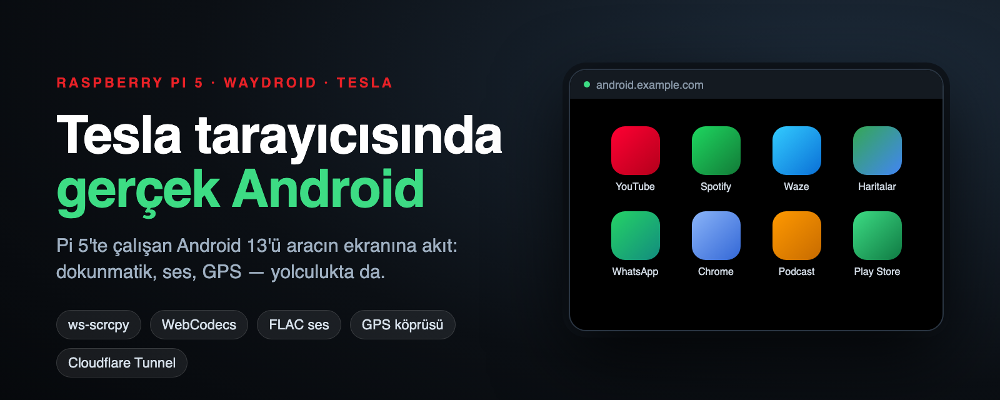
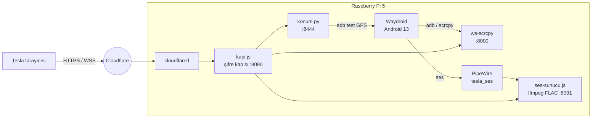

<div align="center">



# 🚗 tesla-android-pi5

**Tesla'nın tarayıcısında gerçek Android. Raspberry Pi 5 ile.**

Dokunmatik · ses · GPS · yolculukta da çalışır

[](#-gerekenler)
[](https://waydro.id)
[](#-tesla-tarayıcısının-tuzakları)
[](https://github.com/NetrisTV/ws-scrcpy)
[](LICENSE)

[Nasıl çalışır](#-nasıl-çalışır) · [Kurulum](#-kurulum) · [Tuzaklar](#-pi-5--waydroid-tuzakları) · [Tesla tuzakları](#-tesla-tarayıcısının-tuzakları) · [Sorun giderme](#-sorun-giderme)

</div>

---

Tesla'da CarPlay ya da Android Auto yok. Ama aracın tarayıcısı var. Bu repo, bir Raspberry Pi 5'te Android 13 çalıştırıp ekranını, sesini ve dokunmatiğini aracın tarayıcısına taşıyan düzeni içeriyor. Pi ofiste, evde ya da araçta durabilir; araç ona internetten, şifreli bir giriş kapısından bağlanır.

> [!NOTE]
> [Tesla Android Project](https://github.com/tesla-android) Pi 5'i desteklemiyor, çünkü Pi 5'te donanım H.264 kodlayıcı yok. Burada kodlama yazılımda yapılıyor. Bu yüzden çözünürlük ve bit hızı Pi 5'in kaldırabileceği noktaya ayarlı.

## ✨ Neler çalışıyor

| Özellik | Durum | Nasıl |
|---|---|---|
| 📺 **Görüntü** | ✅ ~720p, 30 fps | ws-scrcpy, WebCodecs/canvas oynatıcı, 2 Mbps |
| 👆 **Dokunmatik** | ✅ | ws-scrcpy kontrol kanalı |
| 🔊 **Ses** | ✅ | PipeWire → ffmpeg FLAC/fMP4 → `<audio>` + MediaSource |
| 📍 **GPS** | ✅ | Tarayıcının konumu → Android test konum sağlayıcısı |
| 🚗 **Yolculukta** | ✅ | `<video>` yerine canvas, kopunca kendiliğinden yeniden bağlanma |
| 🔐 **Uzaktan erişim** | ✅ | Cloudflare Tunnel + kendi şifre kapısı (1 yıllık imzalı çerez) |
| ▶️ **YouTube, Spotify, Waze, Haritalar** | ✅ | Play Store (GAPPS imajı) |
| 🎬 **Netflix ve DRM'li video** | ❌ | Widevine L1 yok |

## 🧭 Nasıl çalışır



| Parça | Dosya | Görevi |
|---|---|---|
| Android oturumu | [`pi/waydroid-oturum.sh`](pi/waydroid-oturum.sh) | labwc açılınca Waydroid oturumunu başlatır |
| Ekran akışı | [`pi/ws-scrcpy.sh`](pi/ws-scrcpy.sh), [`ws-scrcpy/`](ws-scrcpy/) | Android açılınca adb'ye bağlanır, yamalı ws-scrcpy'yi çalıştırır |
| Giriş kapısı | [`pi/kapi.js`](pi/kapi.js), [`pi/giris.html`](pi/giris.html) | Şifre (scrypt), imzalı çerez, 10 dk'da 5 hata kilidi; ekran, ses ve konumu tek adrese toplar |
| Ses | [`pi/ses-sunucu.js`](pi/ses-sunucu.js), [`web/ses.js`](web/ses.js), [`pi/audioplayback.js`](pi/audioplayback.js) | Android sesini FLAC/fMP4 parçalarıyla tarayıcıya akıtır |
| GPS | [`pi/konum.py`](pi/konum.py), [`web/konum.js`](web/konum.js) | Aracın konumunu Android'e test GPS'i olarak verir |
| Doğrudan açılış | [`web/dogrudan.js`](web/dogrudan.js) | Çıplak adres cihaz listesi yerine doğrudan Android ekranını açar |
| Bekçi | [`web/nabiz.js`](web/nabiz.js) | Bağlantı koparsa, asılı kalırsa ya da veri kesilirse sayfayı yeniler |
| Açılış animasyonu | [`web/acilis.js`](web/acilis.js) | İlk açılışta yükleme ekranı |
| Tünel | [`pi/tunel.yml`](pi/tunel.yml) | Cloudflare Tunnel yapılandırması |
| Güvenlik duvarı | [`pi/guvenlik.nft`](pi/guvenlik.nft) | ws-scrcpy ve konum portlarını yalnız Pi'nin kendisine açar |
| Servisler | [`systemd/`](systemd/) | Hepsi `systemctl --user` servisi |

## 📦 Gerekenler

- **Raspberry Pi 5** (8 GB önerilir), Raspberry Pi OS Bookworm 64 bit, labwc masaüstü
- Hızlı bir disk (NVMe ya da iyi bir SSD; SD kart yavaş kalır)
- **Waydroid 1.6+**, LineageOS 20 **GAPPS** imajı (Android 13)
- Node.js 18+, Python 3, `ffmpeg`, `adb`
- Pi'yi internetten açmak için bir alan adı ve Cloudflare hesabı (Tunnel ücretsiz)
- Tesla tarafında: aracın tarayıcısı (2024 Model Y, yazılım 2024.44.25+ ile denendi)

## 🚀 Kurulum

Aşağıdaki yollar kullanıcı adını `pi` varsayar. Farklıysa dosyalardaki `/home/pi` yollarını değiştir.

### 1. Pi 5'i Android'e hazırla

```bash
# 4K sayfalı çekirdek + PSI (ayrıntı: config/boot/README.md)
sudo cp /boot/firmware/config.txt{,.yedek}; sudo cp /boot/firmware/cmdline.txt{,.yedek}
echo 'kernel=kernel8.img' | sudo tee -a /boot/firmware/config.txt
sudo sed -i '1 s/$/ psi=1/' /boot/firmware/cmdline.txt

# 32 bit ses HAL'i için pid sınırı
sudo cp config/sysctl/90-waydroid-pid.conf /etc/sysctl.d/
sudo reboot
```

### 2. Waydroid

```bash
curl -s https://repo.waydro.id | sudo bash
sudo apt install waydroid
sudo waydroid init -s GAPPS
```

Sonra:

- [`config/waydroid/waydroid.cfg.ek`](config/waydroid/waydroid.cfg.ek) içindeki `debug.stagefright.ccodec = 4` satırını `/var/lib/waydroid/waydroid.cfg` dosyasının `[properties]` bölümüne ekle, `sudo waydroid upgrade --offline` çalıştır.
- Android görünmediğinde donmasın: `waydroid prop set persist.waydroid.suspend false`
- Android ekran boyutu: [`config/kanshi/config`](config/kanshi/config) dosyasını `~/.config/kanshi/config` olarak kopyala.
- adb için Android'de **Geliştirici seçenekleri → USB hata ayıklama** açık olsun. Bağlantı `unauthorized` derse Pi'nin `~/.android/adbkey.pub` içeriğini Android'de `/data/misc/adb/adb_keys` dosyasına yaz.

### 3. ws-scrcpy (yamalı)

```bash
git clone https://github.com/NetrisTV/ws-scrcpy.git ~/ws-scrcpy
cd ~/ws-scrcpy && git checkout cd6cea6
git apply ~/tesla-android-pi5/ws-scrcpy/ws-scrcpy-src.patch
npm install && npm run dist

# sayfaya eklenen betikler
cp ~/tesla-android-pi5/web/*.js ~/tesla-android-pi5/web/index.html dist/public/
cp ~/tesla-android-pi5/pi/audioplayback.js ~/tesla-android-pi5/pi/audio-ws-worker.js dist/public/
```

Yamanın yaptıkları ([`ws-scrcpy/ws-scrcpy-src.patch`](ws-scrcpy/ws-scrcpy-src.patch)):

- Akış en fazla 720 px, 2 Mbps, 30 fps. Pi 5'in yazılım kodlayıcısı bunun üstünde kare düşürüyor. Görüntü tarayıcıda CSS ile büyütülüyor, dokunma koordinatları doğru kalıyor.
- Anahtar kare aralığı 1 sn. Kopuştan sonra görüntü 1 sn içinde toparlanıyor.
- WebCodecs oynatıcısı yeniden bağlanınca IDR gelene kadar ara kareleri atıyor. Yoksa tarayıcı "key frame required" hatasıyla doluyor.

### 4. Ses

```bash
sudo apt install ffmpeg
mkdir -p ~/.config/pipewire/pipewire.conf.d
cp config/pipewire/tesla-ses.conf ~/.config/pipewire/pipewire.conf.d/
systemctl --user restart pipewire wireplumber
```

Android sesi `tesla_ses` adlı sanal çıkışa düşer, `ses-sunucu.js` bunun monitörünü yakalayıp FLAC/fMP4 parçalarına çevirir. ffmpeg yalnız dinleyen varken çalışır.

### 5. Dosyaları yerleştir ve servisleri aç

```bash
mkdir -p ~/tesla-android && cp pi/* ~/tesla-android/
cp systemd/*.service ~/.config/systemd/user/
sudo loginctl enable-linger $USER   # oturum açılmadan da çalışsın

systemctl --user daemon-reload
systemctl --user enable --now waydroid-oturum ws-scrcpy ses konum kapi
```

> [!IMPORTANT]
> ws-scrcpy'nin ve konum sunucusunun kendi kimlik doğrulaması yok. Ağdaki herhangi bir cihaz :8000'e bağlanıp Android'i kontrol edebilir. Bu portları yalnız Pi'nin kendisine aç, dışarıya her şey şifre kapısından geçsin:
>
> ```bash
> sudo mkdir -p /etc/nftables.d && sudo cp pi/guvenlik.nft /etc/nftables.d/tesla.nft
> sudo nft -f /etc/nftables.d/tesla.nft
> ```
>
> Kalıcı olması için `/etc/nftables.conf` içine `include "/etc/nftables.d/tesla.nft"` ekle ve `sudo systemctl enable nftables` çalıştır.

### 6. Giriş şifresi

```bash
printf '%s' 'en-az-8-karakterli-sifre' | node ~/tesla-android/kapi.js sifre
```

Şifreyi her değiştirdiğinde tüm eski oturumlar kapanır. Araç tarayıcısı şifreyi bir kez sorar, 1 yıl hatırlar.

### 7. Cloudflare Tunnel

```bash
cloudflared tunnel login
cloudflared tunnel create tesla-android           # UUID'yi not al
# pi/tunel.yml içinde TUNNEL-UUID ve android.example.com'u kendi değerlerinle değiştir
cloudflared tunnel --config ~/tesla-android/tunel.yml route dns <UUID> android.example.com
systemctl --user enable --now tunel
```

> [!WARNING]
> Pi'de başka bir tünel varsa (`/etc/cloudflared/config.yml`) `cloudflared` onu varsayılan olarak okur. `route dns` komutunu **mutlaka** `--config` ve UUID ile çalıştır, yoksa DNS kaydı yanlış tünele gider ve 530 hatası alırsın.

Araçta tarayıcıyı aç, `https://android.example.com` adresine git, şifreyi gir. Tamam.

## 🧱 Pi 5 + Waydroid tuzakları

Her biri saatlerce uğraştırdı:

| Belirti | Sebep | Çözüm |
|---|---|---|
| Waydroid hiç açılmıyor | Pi 5 çekirdeği 16K sayfa kullanıyor | `config.txt` → `kernel=kernel8.img` |
| Android 16 sn sonra kapanıyor | PSI kapalı, `lmkd` çıkıyor | `cmdline.txt` → `psi=1` |
| Akış siyah | Waydroid görünmeyen Android'i donduruyor | `persist.waydroid.suspend false` |
| YouTube "stuck.bufferfull" | OMX yazılım çözücü minigbm ile takılıyor | `debug.stagefright.ccodec = 4` (Codec2) |
| Pi bir gün açık kalınca YouTube sonsuz yükleniyor | 32 bit ses HAL'i pid > 65535'te çöküyor | `kernel.pid_max = 65535` |
| Dil değiştirdikten sonra ağ ve adb gitti | `system_server` öldürüldü | Arayüzü yenilemek için `systemctl --user restart waydroid-oturum` |

Canlı onarım, ses servisi ölmüşse: `sudo waydroid shell -- sh -c "kill -9 <hal_pid> <audioserver_pid>"`. `init` onları küçük pid'lerle yeniden başlatır. Teşhis: `logcat -b crash | grep audioserver`.

## 🚘 Tesla tarayıcısının tuzakları

| Belirti | Sebep | Çözüm |
|---|---|---|
| Vitese geçince görüntü donuyor | Tesla hareket halinde `<video>` öğesini durduruyor | Görüntü canvas'a çiziliyor (WebCodecs, yoksa Tiny H264) |
| `AudioContext` çalışmıyor | Tesla tarayıcısında yok | Ses `<audio>` + MediaSource (FLAC/fMP4) ile çalınıyor ([Tesla Android](https://github.com/tesla-android/frontend)'in oynatıcısı) |
| D'ye geçince bağlantı kopuyor | Araç Wi-Fi'den LTE'ye geçiyor, IP değişiyor | `nabiz.js` soket kapanınca sayfayı yeniliyor |
| Bağlantı "bağlanıyor"da asılı kalıyor | Ağ değişiminden sonra yarı ölü soket | `nabiz.js`: 6 sn asılı, 8 sn veri yok ya da 15 sn ekransız → yenile |
| Güncelleme yaptın ama araç eski JS'i çalıştırıyor | `no-cache`'e rağmen önbellek | `index.html` içinde betiklere `?v=<tarih>` ekle, her güncellemede değiştir |
| Konum gelmiyor | Geolocation HTTPS ister | Tünel zaten HTTPS. Yerel ağda kullanıyorsan geçerli sertifika gerekir |

> [!TIP]
> Sürüşte neler olduğunu görmek için `nabiz.js` her 2 saniyede kapıya durum bildirir: `journalctl --user -u kapi -f`. Hangi soket ne zaman kapandı, sayfa görünür mü, ses çalıyor mu, hepsi orada.

## 🛠️ Sorun giderme

```bash
# Servisler ayakta mı?
systemctl --user status waydroid-oturum ws-scrcpy ses konum kapi tunel

# Android açıldı mı?
adb -s 192.168.240.112:5555 shell getprop sys.boot_completed

# Kodlayıcı hangi çözünürlükte çalışıyor?
adb -s 192.168.240.112:5555 logcat -d | grep C2SoftAvcEnc

# Ses hattı
pactl list short sinks | grep tesla_ses
```

| Sorun | Bak |
|---|---|
| Ekran siyah, dokunma çalışıyor | Android donmuş: `waydroid prop get persist.waydroid.suspend` |
| Görüntü takılıyor | Çözünürlüğü yükseltme. 720 px / 2 Mbps Pi 5'in sınırı |
| Ses yok | İlk dokunuştan sonra başlar (tarayıcı kuralı). `journalctl --user -u ses` |
| Araç tarayıcısı hep eski sürüm | Tarayıcıyı kapatıp aç, `?v=` değerini değiştir |

## 📁 Repo yapısı

```
pi/          Pi'de ~/tesla-android altına giden betikler ve sunucular
web/         ws-scrcpy'nin dist/public klasörüne eklenen sayfa betikleri
ws-scrcpy/   ws-scrcpy kaynak yaması
systemd/     kullanıcı servisleri
config/      kanshi, PipeWire, sysctl, Waydroid ve boot ayarları
```

[`pi/guvenlik.nft`](pi/guvenlik.nft) kimlik doğrulamasız portları dışarıya kapatır, mutlaka yükle. [`pi/wifi-duzen.sh`](pi/wifi-duzen.sh), [`pi/bt-esle.sh`](pi/bt-esle.sh) ve [`pi/bt-ses.sh`](pi/bt-ses.sh), Pi'nin araçta durduğu ilk düzenden kalma: Pi kendi "Tesla" Wi-Fi yayınını açıyor, ses Bluetooth ile araca gidiyordu. Tünel düzeninde gerekmiyorlar ama Pi'yi araçta tutmak isteyen için duruyorlar.

## 🙏 Teşekkür

- [ws-scrcpy](https://github.com/NetrisTV/ws-scrcpy) (MIT): tarayıcıda scrcpy
- [Waydroid](https://waydro.id): Linux'ta Android
- [Tesla Android Project](https://github.com/tesla-android) (GPLv3): ses oynatıcısı ve Tesla tarayıcısı üzerine birikim

## 📄 Lisans

[GPL-3.0](LICENSE). `pi/audioplayback.js` ve `pi/audio-ws-worker.js`, Tesla Android Project'in GPLv3 lisanslı ön yüzünden uyarlandı, bu yüzden repo da GPLv3.

Bu proje Tesla, Inc. ile bağlantılı değildir. Sürerken ekranla oynama; yolculukta görüntüyü yolcu kullansın.
